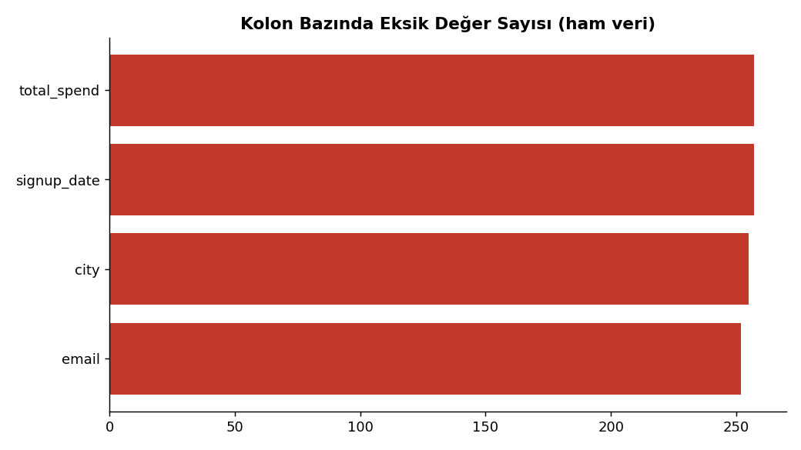

# Data Quality Checks

Finds and fixes common problems in a customer table before it is used for
reporting: missing values, duplicates, invalid emails, impossible ages and
inconsistent date, number and city formats.



## Data

A 10,120-row customer table with the problems above. The data is synthetic
and comes from `python/01_generate_dirty_data.py`.

## Checks and fixes

| Problem | Example | Fix |
|---|---|---|
| Duplicate rows | same record twice | removed |
| Date format | `05/03/2022`, `10.12.2024` | converted to `2022-03-05` |
| Number format | `1385,39`, `1385.39 TL` | converted to `1385.39` |
| City name | `lefkosa`, ` GIRNE ` | `Lefkoşa`, `Girne` |
| Invalid email | `not-an-email` | set to empty for review |
| Impossible age | `999`, `-5` | set to empty for review |

## Results

| | Raw | Clean |
|---|--:|--:|
| Rows | 10,120 | 10,003 |
| Duplicate rows | 117 | 0 |
| ISO date format | 33% | 100% |
| Numeric spend format | 33% | 100% |
| Standard city name | 62% | 100% |

About 2.5% of email, city, date and spend values are missing in the source.
These cannot be fixed automatically and have to be completed at the source.

## Files

- `sql/data_quality_checks.sql`: the same checks in PostgreSQL
- `python/02_data_quality_check.py`: checks, cleaning, `data/customers_clean.csv`
  and `reports/data_quality_report.csv`

## Run

```bash
pip install -r requirements.txt
python python/01_generate_dirty_data.py
python python/02_data_quality_check.py
```
